# Oatmeal

A small, private meeting-notes app for macOS and Linux (built and tested on [Omarchy](https://omarchy.org)). When you join a call in Zoom, Meet, Teams, Slack, Discord or FaceTime, Oatmeal offers to transcribe it. When the call ends, it writes notes: a summary, decisions, action items and open questions.

Everything runs on your computer: speech-to-text with [Moonshine](https://github.com/moonshine-ai/moonshine), notes with [Gemma 4](https://ai.google.dev/gemma) through [llama.cpp](https://github.com/ggml-org/llama.cpp). Audio is never saved, and nothing is uploaded. Oatmeal only goes online to download models and to check GitHub for app updates (you can turn that off in Settings).

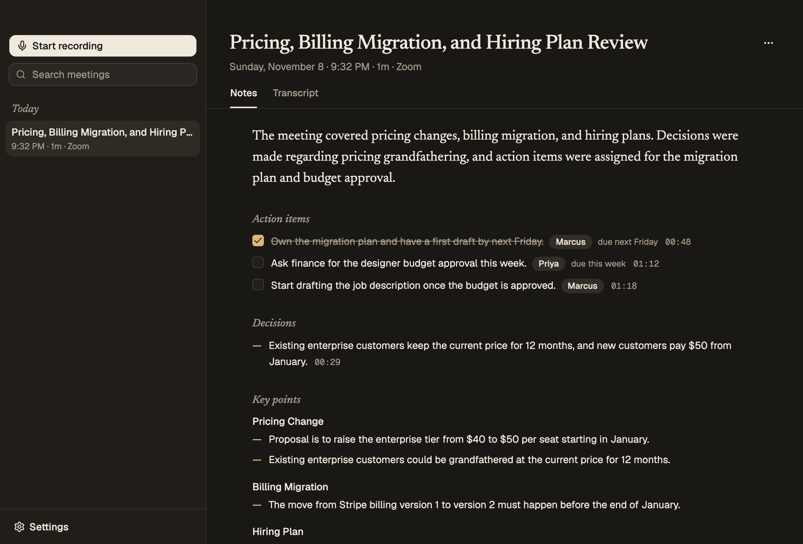

> **Status:** beta. The full pipeline works end to end. Live capture from a real call still needs testing on more setups.

## Install

Download the latest build from [GitHub Releases](https://github.com/angelplusultra/oatmeal/releases) (currently pre-releases):

- **macOS 15+ on Apple Silicon:** `Oatmeal-<version>-arm64.dmg`, signed and notarized
- **Linux x64:** `Oatmeal-<version>.AppImage`, or on Arch `sudo pacman -U oatmeal-<version>.pacman`. Needs PipeWire (`pw-record`, and `pactl` from pipewire-pulse)

On first launch, a short setup asks for audio access (macOS) and downloads the models. Oatmeal then lives in the menu bar and updates itself from GitHub Releases. On Linux, only the AppImage updates itself; the pacman package updates through pacman.

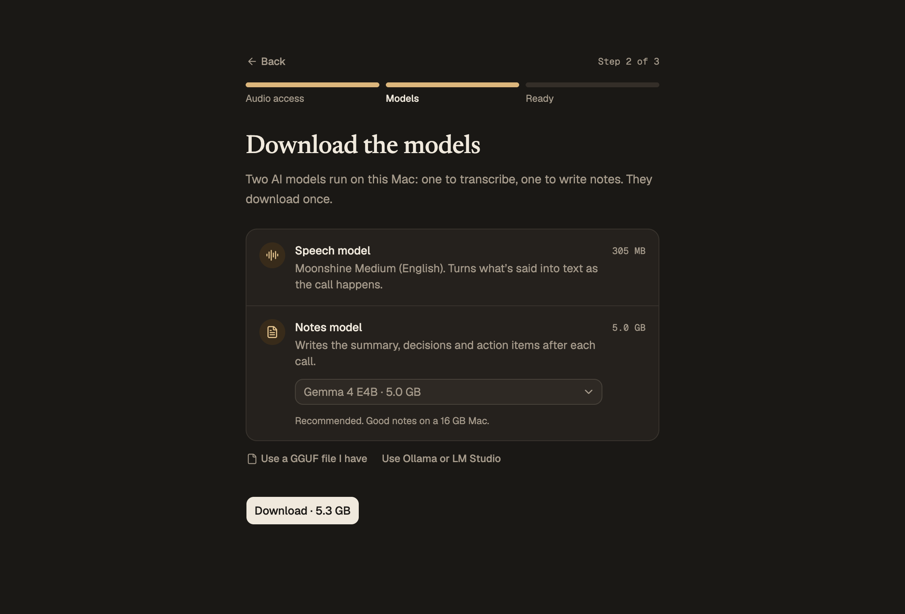

## Features

<table>
  <tr>
    <td>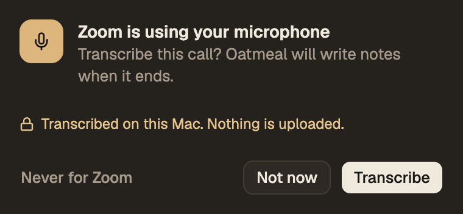</td>
    <td>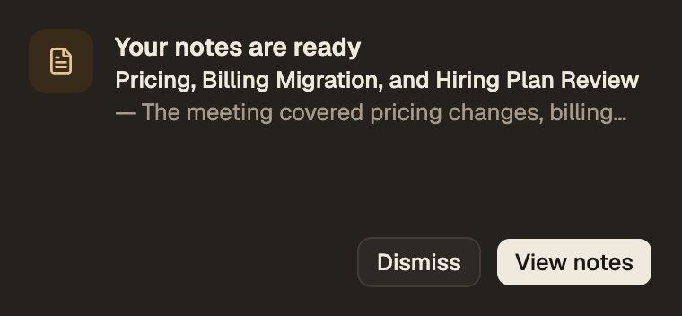</td>
  </tr>
</table>

- **Call detection.** When Zoom, Teams, Slack, Discord, FaceTime, Webex or WhatsApp starts using the microphone, or a browser does (for Meet and other web calls), Oatmeal shows a small "Transcribe this call?" panel. **Never for…** stops asking for that app. Recording runs in the background, with a red menu-bar icon and no windows. It stops about 2 seconds after the app releases the mic and goes quiet. If you're only muted, it keeps recording.
- **Notes ready.** When the notes are written, the same panel offers **View notes** or **Dismiss**. Nothing opens until you ask.
- **Two-channel transcription.** Your microphone is "You". Everyone else comes from system audio and can be split into Speaker 1, Speaker 2… Click a name to rename it. **Regenerate notes** then uses the new names.
- **Notes.** A summary, action items (with owners and due dates, and check-offs), decisions, key points and open questions. Every decision and action item links back to the moment it was said.
- **Your choice of notes model.** Gemma 4 E2B, E4B (the default) or 26B A4B, built in with llama.cpp. Oatmeal finds a Gemma GGUF already on disk from LM Studio, llama.cpp or Hugging Face, or you can pick any GGUF file or point it at an OpenAI-compatible server you run (Ollama, LM Studio, llama-server).
- **Your data.** Transcripts are searchable, viewable and exportable as .txt, .md or .json. Notes copy or export as Markdown.
- **Omarchy themes.** On Omarchy, Oatmeal takes its colors and corner rounding from your desktop theme, and follows `omarchy theme set` live.

<table>
  <tr>
    <td>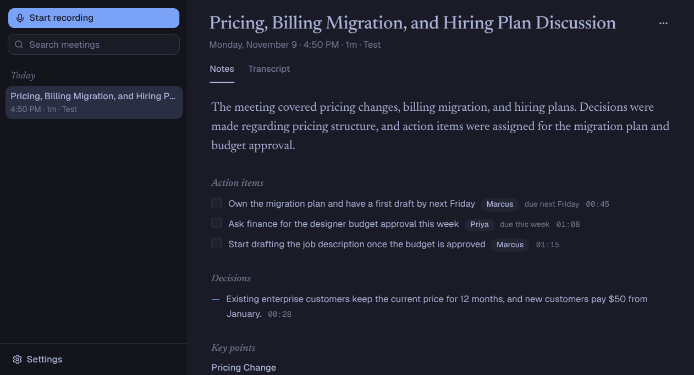</td>
    <td>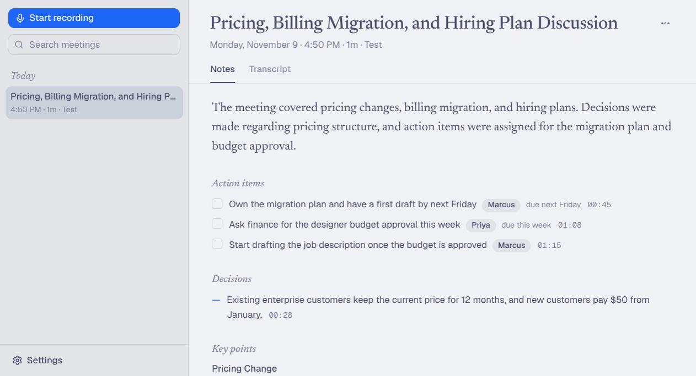</td>
  </tr>
  <tr>
    <td>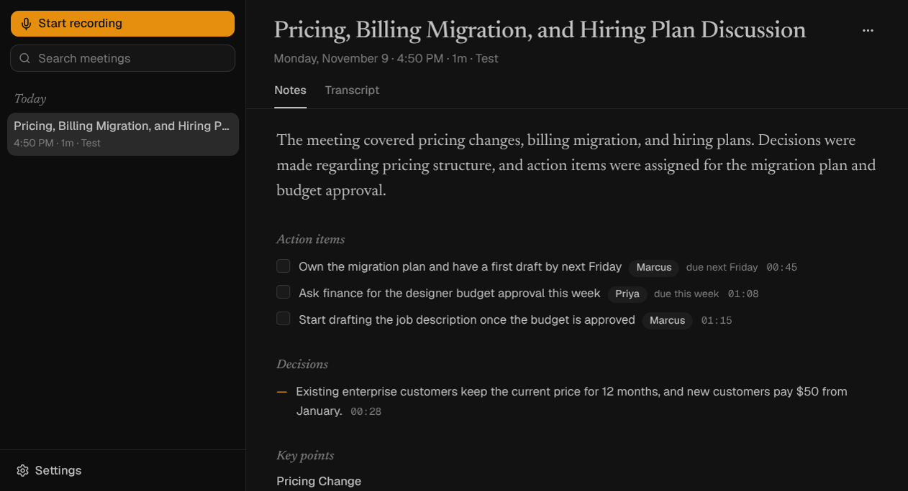</td>
    <td>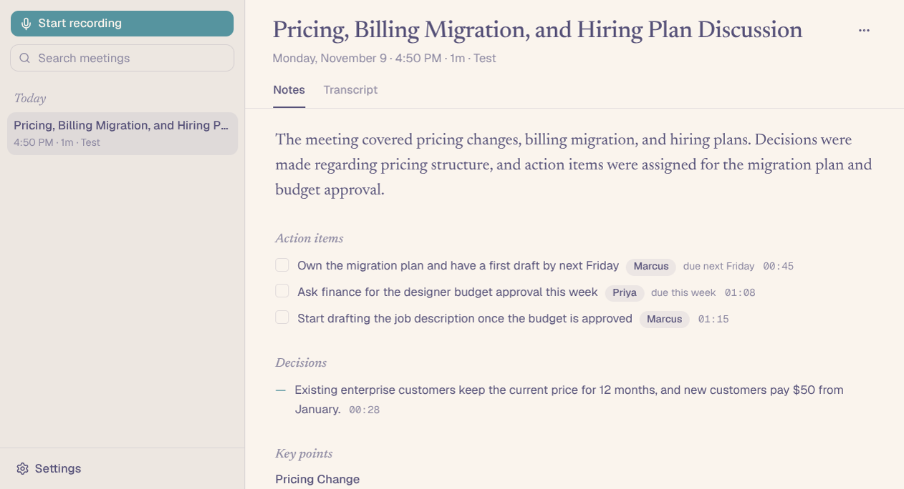</td>
  </tr>
</table>

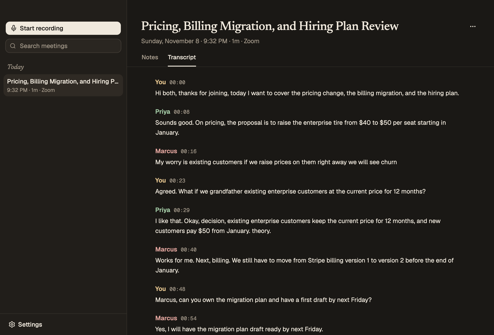

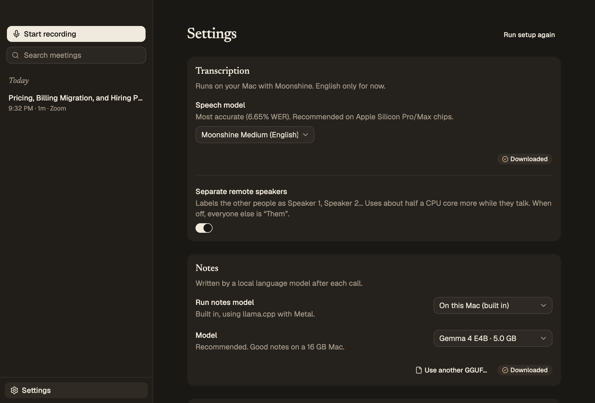

## Building from source

### Requirements

- macOS 15 or later on Apple Silicon, with Xcode Command Line Tools (Swift 5.9+) to build the audio helper
- or Linux x64/arm64 with glibc 2.34+ and PipeWire (`pw-record`, and `pactl` from pipewire-pulse), plus `bsdtar` for setup. Notes run on CUDA or Vulkan when available, otherwise the CPU
- Node.js 22.12+ and npm

### Getting started

```bash
npm install
npm run dev
```

`npm run dev` first runs `npm run setup`, which:

1. downloads the native Moonshine library from the official `moonshine-voice` wheel on PyPI (checksum-verified) into `resources/moonshine/`
2. on macOS, builds the Swift audio helper into `resources/bin/oatmeal-audio`

On first launch, a short setup walks through the two macOS permissions and downloads the speech model (~300 MB) and the notes model (Gemma 4 E4B, 5 GB, or E2B / 26B-A4B), both at once. Oatmeal doesn't offer to transcribe calls until setup is done. **Settings → Run setup again** repeats it, and `OATMEAL_USER_DATA=/some/empty/dir npm run dev` shows it as a new user sees it (except the permission prompts, which need the packaged app).

**Permissions in development.** macOS gives microphone and system-audio access to whatever launched Electron, so run `npm run dev` from an app that declares both permissions in its Info.plist (`NSMicrophoneUsageDescription` and `NSAudioCaptureUsageDescription`). T3 Code, VS Code and Cursor do. Ghostty only declares the microphone, so system audio comes through silent. Terminal.app declares neither. Use **Settings → Permissions → Allow**, and macOS will ask on behalf of that app.

**Linux** needs no permissions. Oatmeal records through PipeWire: the default mic, plus a monitor of the default output for everyone else. On Hyprland it adds a window rule at runtime (`hyprctl eval`) so the call panel floats, pinned, in the top-right corner without taking focus.

To see the real permission flow on macOS, with "Oatmeal" in the dialogs, build the app and run it from Finder:

```bash
npm run dist:mac:local   # ad-hoc signed app in dist/mac-arm64/Oatmeal.app
```

## Scripts

| Command | What it does |
|---|---|
| `npm run dev` | Run with hot reload |
| `npm run build` | Build main, workers, preload and renderer into `out/` |
| `npm test` | Unit tests (transcript shaping, echo filtering, summarization pipeline, storage) |
| `npm run typecheck` | Type-check all code |
| `npm run dist:mac:local` | Package an ad-hoc signed `.app` for local use |
| `npm run dist:mac` | Package a signed `.dmg` + `.zip` (needs a Developer ID certificate) |
| `npm run dist:linux` | Package an AppImage and an Arch package (`sudo pacman -U dist/oatmeal-*.pacman`) |
| `npm run dist:linux:dir` | Package an unpacked app in `dist/linux-unpacked/` |
| `npm version patch\|minor\|major` | Bump the version, tag it and push; CI publishes the release |
| `npm run make-test-meeting -- <dir>` | Generate a synthetic two-channel meeting with macOS voices (on Linux, Piper voices: see the script) |

### End-to-end testing without a real call

```bash
npm run build
npm run make-test-meeting -- /tmp/meeting
OATMEAL_USER_DATA=/tmp/oatmeal-test OATMEAL_SETUP=asr OATMEAL_AUTOSTART=1 \
OATMEAL_FAKE_AUDIO="mic=/tmp/meeting/mic.wav,system=/tmp/meeting/system.wav,speed=1.5" \
OATMEAL_SCREENSHOT_DIR=/tmp/oatmeal-shots OATMEAL_EXIT_AFTER_NOTES=1 \
npx electron .
```

This plays the WAV files as the two capture channels, transcribes them, writes notes, saves screenshots and quits. Other hooks are documented in `src/main/dev.ts` (e.g. `OATMEAL_LLM_MODEL_PATH` to use an existing GGUF, `OATMEAL_DEMO_PROMPT=1` to show the call prompt).

## How it works

Here's what happens during a call, start to finish. All of it runs on your computer.

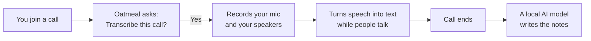

### 1. Noticing a call

Oatmeal keeps an eye on which apps are using your microphone. When a call app (Zoom, Teams, Slack, a browser for Meet…) starts using it, a small panel asks **Transcribe this call?** Nothing is recorded until you say yes.

- **macOS:** a small Swift helper asks Core Audio which apps have the mic open.
- **Linux:** Oatmeal asks PipeWire for the same list (`pactl`).

### 2. Recording both sides

A call has two sides, so Oatmeal records two streams:

| Stream | Who it is | macOS | Linux |
|---|---|---|---|
| Your microphone | You | the mic | the default mic (`pw-record`) |
| What your speakers play | Everyone else | a Core Audio tap on system audio (no Screen Recording permission needed) | the default output (`pw-record`) |

The audio stays in memory. It goes straight to speech-to-text and is never written to disk.

### 3. Turning speech into text

[Moonshine](https://github.com/moonshine-ai/moonshine) transcribes both streams as the call goes on. Each line shows up in the transcript shortly after it's said.

- **Who said what.** Your mic is always "You". On the other stream, Oatmeal tells voices apart and labels them Speaker 1, Speaker 2… Click a name to rename it.
- **Echo.** Without headphones, your mic also hears the other people through your speakers, so their words would show up twice. When a line from your mic says nearly the same words, at the same time, as a line from the speakers, Oatmeal hides the mic copy.

### 4. Knowing when the call is over

When the call app lets go of the mic, Oatmeal checks whether it's still playing sound:

- **No sound either:** you left the call. Recording stops about 2 seconds later.
- **Still playing sound:** you're probably just muted. Recording continues until nobody has spoken for a while (15 seconds by default, set in **Settings → Stop when the call ends**).

### 5. Writing the notes

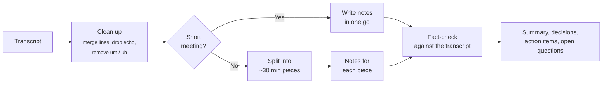

The cleaned-up transcript goes to [Gemma 4](https://ai.google.dev/gemma), running locally through [llama.cpp](https://github.com/ggml-org/llama.cpp) (or to an OpenAI-compatible server you run, if you set one).

- **Short meetings** (up to roughly half an hour of talk) fit in one go, and the model writes the notes in a single pass.
- **Longer meetings** are split into pieces. The model writes notes for each piece, then combines them into one set.

Either way, Oatmeal checks the model's work in plain code before showing it:

- Every decision and action item must point to the moment it was said. If that moment isn't in the part of the transcript the model was reading, the item is dropped.
- An action item's owner must be someone on the call or a name that was actually said. A due date must use words that were actually said. Otherwise that field is left blank.

The model starts loading as the call ends and unloads after a minute of not being used, so it doesn't hold memory the rest of the day.

### Where your data lives

| What | Where |
|---|---|
| Audio | Nowhere. It's only in memory while it's being transcribed. |
| Transcripts, notes, speaker names | A SQLite database (`oatmeal.db`) in Oatmeal's app data folder |
| Models | Downloaded once, then kept on disk |
| Internet | Used only to download models and check GitHub for updates (you can turn updates off) |

### Where to find it in the code

Oatmeal is an Electron app split into a few processes, so heavy work (audio, models) never slows down the UI.

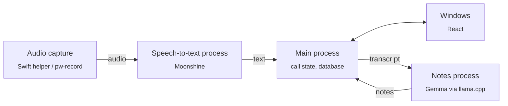

| Part | Code |
|---|---|
| Call detection and audio capture on macOS | `native/macos/OatmealAudio` |
| Call detection and audio capture on Linux | `src/main/pulse.ts`, `src/workers/asr/sources.ts` |
| Speech-to-text | `src/workers/asr` |
| Call flow: asking, recording, stopping, echo | `src/main/orchestrator.ts`, `src/shared/call-end.ts`, `src/shared/echo.ts` |
| Notes | `src/shared/summarize.ts`, `src/workers/llm` |
| Database | `src/main/db.ts` |
| UI | `src/renderer` |

## Credits and licenses

Oatmeal is MIT licensed. It builds on:

- [Moonshine Voice](https://github.com/moonshine-ai/moonshine) (MIT): speech-to-text
- [pyannote speaker-diarization-community-1](https://huggingface.co/pyannote/speaker-diarization-community-1) (CC-BY-4.0), via Moonshine; PLDA by BUT Speech@FIT
- [Gemma 4](https://ai.google.dev/gemma) (Apache 2.0): notes model, downloaded at runtime
- [llama.cpp](https://github.com/ggml-org/llama.cpp) and [node-llama-cpp](https://github.com/withcatai/node-llama-cpp) (MIT)
- [koffi](https://koffi.dev) (MIT), [Electron](https://www.electronjs.org) (MIT), [shadcn/ui](https://ui.shadcn.com) (MIT)
